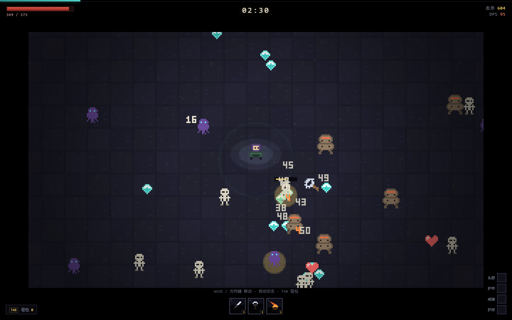

# ASHFALL · 灰烬降临

像素风割草生存 + PoE 式标签联动伤害。纯网页、零依赖、可直接开。



---

## 现在能玩到什么

一局 10 分钟，8 分钟刷首领，**击杀首领即通关**。

- **6 个主动技能**：影刃（近战）、炎爆（投射物+爆炸）、霜环（自身 AoE）、链雷（连锁）、回旋斧（穿透回旋）、陨星（延迟落点）
- **3 个技能槽**，升级时三选一：新技能 / 技能升级（最高 5 级）/ 属性
- **20 种词缀 × 4 个装备部位**，按标签作用于技能
- **5 种敌人 + 精英词缀 + 首领**，10 段难度曲线
- **背包 / 装备对比**（TAB 打开，显示换装后的 DPS 与生命变化）

操作：

| 输入 | 动作 |
|---|---|
| `WASD` / 方向键 | 移动 |
| 自动 | 技能自动索敌释放 |
| `TAB` | 背包（暂停） |
| `R` | 结算界面重开 |

---

## 怎么跑

**方式一：直接双击 `index.html`**（不需要任何东西）

**方式二：起个本地服务**（手机同 WiFi 也能玩）

```bash
node server.js
# 浏览器打开 http://localhost:8123
```

> 端口从 8123 开始自动找空位。**注意本机 8080 被 Steam 的 CEF 调试服务占用**，不要用 8080。
> 如果你没装 Node，DSH 自带了一个：`C:\Users\Administrator\.dsh\dsh-runtimes\dsh-primary-runtime\dependencies\node\bin\node.exe`

---

## 伤害是怎么算的

```
每系伤害 = (基础 + 附加) × (1 + Σ增加) × Π(1 + 更多)
单次命中 = 每系伤害 × 暴击倍率 × (1 − 抗性)
DPS      = 单次命中 × 施法频率
```

**关键是标签联动**：每个词缀都带一个作用域。

- `+30% 火焰伤害` → 只影响带 `fire` 标签的技能（炎爆、陨星）
- `+25% 投射物伤害` → 只影响带 `projectile` 的技能（炎爆、回旋斧）
- `+15% 范围伤害` → 只影响带 `area` 的技能
- `+1 投射物` → 同理

所以**一件装备会同时改多个技能的数值**，这是构筑的乐趣来源：你要让 3 个技能共享尽量多的词缀，而不是各堆各的。

暴击率封顶 100%，冷却缩减封顶 60%，抗性封顶 75% —— 溢出即浪费，这是刻意留的取舍点。

---

## 数值现状（实测，不是拍脑袋）

用会捡经验、会贴身的机器人跑 20 个随机种子：

```
通关 10/20   死亡 2/20   超时未击杀首领 8/20
平均时长 598s   平均击杀 3739   平均等级 57.6
```

单局样例（种子 12345）：1 分钟 155 杀 Lv7，4 分钟 1224 杀 Lv30，9 分钟击杀首领。

**结论**：曲线基本成立，但首领血量对弱势构筑偏高（8/20 超时）。这是下一轮要调的。

---

## 目录结构

```
ashfall/
├── index.html          入口
├── styles.css          像素风 UI
├── server.js           零依赖静态服务器
├── js/
│   ├── sprites.js      像素点阵（23 个精灵 + 3x5 数字字体）
│   ├── data.js         技能 / 词缀 / 怪物 / 难度曲线
│   ├── engine.js       纯数值内核（伤害、掉落、成长曲线）
│   ├── sim.js          世界模拟（纯逻辑，不碰 DOM）
│   ├── render.js       320×180 像素渲染 + 整数倍放大
│   ├── ui.js           DOM 界面
│   └── main.js         输入 / 主循环
├── test/
│   ├── run.js          引擎断言 + 数值曲线报告
│   └── balance.js      20 种子机器人跑分
└── docs/netcode.md     四人联机设计（下一步）
```

**为什么这么分**：`sim.js` 不碰 DOM、不用 `Date.now()`、随机数是可保存的种子状态。这意味着**同一份模拟代码可以直接跑在 Node 服务器上**——联机时不需要重写一套服务端逻辑。这不是顺手做的，是刻意留的接口。

---

## 测试

```bash
node test/run.js       # 8 条伤害断言 + 曲线报告
node test/balance.js   # 20 种子机器人跑分（约 2 分钟）
```

调试参数（无头截图/回归用）：

```
index.html?bot=1&ff=120   # 自动机器人 + 快进 120 秒
```

---

## 已知限制

- **还不能联机**（见 `docs/netcode.md`，架构已预留）
- 只有 1 张地图、1 个首领、5 种怪
- 没有音效
- 没有存档，刷新即重开
- 移动端没做虚拟摇杆
- 首领血量需要下调，让弱势构筑也能通关

---

## 下一步

1. **四人联机**（主机权威 + 快照同步）— 见 `docs/netcode.md`
2. 音效与打击感（命中音、暴击音、升级音）
3. 首领平衡 + 第二种首领
4. 装备词缀扩充到 40+，加传奇
5. 移动端适配

---

## 许可

MIT。像素美术全部是本仓库内用字符点阵手绘的，没有外部素材，没有版权问题。
