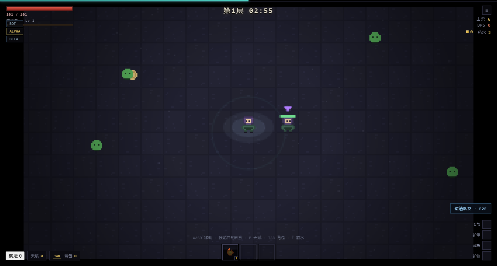

# ASHFALL · 灰烬降临

像素风割草 + PoE 式标签联动伤害 + 主城经济 + 四人联机。**纯网页、零依赖、零外部素材。**



---

## 快速开始

```bash
# 单机：直接双击 index.html，或者
node server.js
# → http://localhost:8123

# 联机（同一房间，最多 4 人）
# 房主：http://localhost:8123/?room=TEST&host=1
# 队友：http://localhost:8123/?room=TEST
```

> 端口从 8123 自动往上找。**本机 8080 被 Steam 的 CEF 调试服务占用，别用。**

## 操作

| 键鼠 | 触屏 | 动作 |
|---|---|---|
| `WASD` / 方向键 | 左下摇杆 | 移动 |
| 自动 | 自动 | 技能索敌释放 |
| `E` / 点提示条 | 点提示条 | 与 NPC 交互 |
| `P` | 天赋按钮 | 天赋树 |
| `TAB` | 背包按钮 | 背包 |
| `F` | — | 喝药水 |
| `≡` | — | 设置（音量 / 操作方式） |

---

## 核心循环

```
第 N 层（3 分钟）
  0:00  刷怪，血量/伤害随层数增长
  2:30  首领降临（第 1、3、5… 层是深渊之眼，第 2、4、6… 层是骸骨之王）
  3:00  强制回城
主城（1 分钟倒计时）
  商人 / 铁匠 / 仓库 / 交易行 / 赌徒 / 裂隙之门
```

打开面板时倒计时暂停，可以慢慢整理。

## 伤害模型

```
每系伤害 = (基础 + 附加) × (1 + Σ增加) × Π(1 + 更多)
单次命中 = 每系伤害 × 暴击倍率 × (1 − 抗性)
DPS      = 单次命中 × 施法频率
```

词缀按**标签**联动：`+40% 火焰` 只影响带 `fire` 的技能，`+1 投射物` 只影响带 `projectile` 的。所以构筑的核心是让三个技能共享尽量多的标签。

## 天赋树（火炬之光式）

三棵树（刃 / 焰 / 雷）× 五层 × 每节点可升多级：
- 层解锁：在该树投入 0 / 4 / 8 / 12 / 16 点
- 主动技能节点升到 1 级即学会该技能（最多同时带 3 个）
- 技能等级 = 节点等级
- 洗点免费

## 装备与掉落

- 4 个部位，25 种词缀，5 个阶级，稀有度 普通/魔法/稀有/传奇
- 掉落**全部落在地上**，60 秒后消失（最后 8 秒闪烁），谁捡到归谁
- 传奇 4 件（屠戮者 / 焚心 / 雷罚 / 不朽）
- 铁匠：重铸词缀 / 增加词缀 / 提升品质
- 赌徒：花钱买**指定部位**的保底稀有装备（后期金币主要出口）

## 联机

主机权威：房主的浏览器跑完整模拟，服务器只做房间与转发，客户端只发输入、只渲染快照。

- 房间上限 4 人，先到者是房主
- **断线重连**：token 认领，掉线角色保留 30 秒
- **房主迁移**：房主掉线立刻移交，新房主用明细重建世界
- 快照 15Hz + 客户端插值，明细 2Hz
- 经验按 320 单位半径共享；掉落共享，先到先得

详见 [docs/netcode.md](docs/netcode.md)。

## 音效

全部 WebAudio 现场合成，仓库里没有任何音频文件：命中、暴击、击杀、受伤、拾取（稀有度越高音越高）、升级、首领、施法（每个技能不同音色）。设置里可调音量或静音。

---

## 内容清单

| 类别 | 数量 |
|---|---|
| 主动技能 | 6（影刃 / 炎爆 / 霜环 / 链雷 / 回旋斧 / 陨星） |
| 词缀 | 25 |
| 传奇装备 | 4 |
| 怪物 | 6 种（含远程「腐化喷吐者」） |
| 首领 | 2（深渊之眼 / 骸骨之王） |
| 主城 NPC | 6 |
| 像素精灵 | 31 |

## 测试

```bash
node test/run.js       # 引擎断言 10
node test/mp.js        # 多人逻辑断言 10
node test/net.js       # 联机协议断言 11（含断线重连、房主移交、满员）
node test/e2e.js       # 端到端：Node 房主 + 2 个浏览器客户端
node test/balance.js   # 20 种子 × 30 分钟跑分
```

最近一次全量结果：**语法 13/13、引擎 10/10、多人 10/10、协议 11/11、端到端 5/5**。

平衡（30 分钟 × 20 种子）：`死亡 7/20，平均到达第 7.2 层，平均击杀 6978，平均等级 82`。

调试参数：

```
index.html?bot=1&ff=90        机器人快进 90 秒
index.html?scene=town         直接进主城
index.html?panel=talent       直接开天赋树（shop/smith/stash/market/bag/settings 同理）
index.html?room=TEST&host=1   联机
```

## 目录

```
ashfall/
├── index.html
├── styles.css
├── server.js            静态服务 + 房间 + WebSocket
├── server/ws.js         最小 RFC6455 实现（零依赖）
├── js/
│   ├── sprites.js       点阵精灵
│   ├── data.js          技能 / 词缀 / 传奇 / 天赋 / 怪物 / 主城 / 经济
│   ├── engine.js        纯数值内核
│   ├── sim.js           世界模拟（纯逻辑，可跑在 Node）
│   ├── hostcore.js      快照打包 / 客户端视图
│   ├── render.js        320×180 像素渲染
│   ├── audio.js         WebAudio 合成音效
│   ├── net.js           联机客户端
│   ├── act.js           动作分发（单机直改 / 联机转发）
│   ├── ui.js            HUD / 主城 / 天赋 / 商店 / 触屏
│   └── main.js          输入与主循环（单机 / 主机 / 客户端）
├── test/                5 个测试脚本
└── docs/netcode.md      联机设计
```

**关键设计**：`sim.js` 不碰 DOM、不用 `Date.now()`、随机数是可序列化种子——所以同一份模拟既能跑在浏览器，也能跑在 Node（房主机器人就是这么做的）。

## 已知限制

1. 房主迁移后世界会重置（怪物/波次重来），只保留角色数据
2. 快照是全量下发，没做视野裁剪（4 人 200 怪时约 40KB/s/客户端）
3. 客户端看不到伤害飘字（只有主机生成）
4. 主城没有建筑，只有 NPC 与地板
5. 移动端只做了摇杆，没做横屏适配

## 许可

MIT。所有像素美术都是仓库内用字符点阵手绘，无外部素材。

---

## 三个核心创意系统（v0.8）

### 1. 深渊裂隙 —— 每层之间的风险选择

每层战斗结束后，从三张裂隙卡里选一张决定下一层的规则：

| 裂隙 | 代价 | 回报 |
|---|---|---|
| 疾行 | 敌人移速 +35% | 掉落品质 +1 |
| 血月 | 敌人伤害 +45% | 金币 +90% |
| 贫瘠 | 不再掉金币 | 装备掉落 +160% |
| 狂潮 | 敌人数量 +50% | 经验 +50% |
| 精英狩猎 | 精英率 ×3 | 精英必掉装备 |
| 时限 | 战斗缩短到 120 秒 | 掉落品质 +2 |
| 深渊凝视 | 首领提前 60 秒 | 掉落品质 +2，但敌人血 -25% |
| 贪婪 | 治疗 -50% | 金币 +150% |

裂隙**叠加影响整层**：怪物属性、刷怪密度、掉落、经验、金币、战斗时长、首领时机。这是每局变得不一样的来源——不是随机地图，是随机规则。

### 2. 词缀共鸣 —— 让构筑看得见

装备上同一标签堆到 **3 / 5 / 8 条**，自动解锁阶梯效果。天赋面板顶部实时显示：

```
火焰 6/8   冰霜 0/8   闪电 0/8   物理 0/8   投射物 3/8   范围 0/8
```

- 火焰 3 → 点燃伤害 +60%；5 → 12% 更多火焰；8 → 再 25% 更多火焰
- 闪电 3 → 连锁 +1；5 → 12% 更多闪电；8 → 再 25%
- 投射物 3 → +1 投射物；5 → 20% 更多投射物伤害；8 → +2 穿透
- 物理 / 冰霜 / 范围同理

它把"堆词缀"从数值游戏变成了**看得见的里程碑**：你会为了凑第 3 条火而换掉一件更好的装备。

### 3. 狂潮 —— 战斗里的张力条

击杀积攒狂潮（每杀 +2.5），挨打立刻清零。满 100 触发 **8 秒狂潮**：攻速 ×1.54、移速 ×1.2、屏幕泛橙。

这让"贪一刀还是退一步"变成每秒都在做的决定——站着输出会死，但停下来狂潮就没了。
---

## 跨局进度（v0.9）

**深渊精华**：每局结束结算，`层数×12 + 击杀/80 + 首领×25`，永久保存。

**深渊祭坛**（主城左下角「祭坛」按钮）：花精华买永久加成，共 8 项、可多级。

| 祭坛 | 效果 | 上限 |
|---|---|---|
| 启程之赐 | 初始金币 +250/级 | 5 |
| 贪婪之血 | 金币获取 +10%/级 | 5 |
| 强健体魄 | 初始生命 +18/级 | 5 |
| 天赋早慧 | 开局额外 1 天赋点/级 | 3 |
| 拾荒者 | 装备掉落 +8%/级 | 5 |
| 先见 | 裂隙多一个选项/级 | 2 |
| 传承 | 开局获得一件随机稀有装备 | 1 |
| 回响 | 狂潮持续 +2 秒/级 | 3 |

**每日裂隙**：祭坛里点「今日裂隙」，所有人当天用同一个种子跑同一条线，成绩记在本地。这是给玩家一个「今天也得来一趟」的理由，而且不用做服务器。

**为什么这样设计**：割草游戏最容易死在「第 20 小时」。永久进度不是数值通胀，而是**允许玩家尝试更冒险的构筑**——有了「传承」的开局装备和「先见」的第四个裂隙选项，你才敢去选「贫瘠」。
---

## 开局体验（v0.10）

**首次进入有引导。** 六个词说清全部玩法：移动 / 战斗 / 裂隙 / 主城 / 成长 / 狂潮，只出现一次。

**开局第一件事就是做选择。** 新开一局，你会先看到三张深渊裂隙卡——选完才进战斗。第一次游玩的人在前 10 秒内就完成了一个有代价的决策，而不是先看 3 分钟自动打怪。

**联机一键邀请。** 进入房间后右上角出现「邀请队友 · 房间名」按钮，点一下复制链接。两个客户端实测（`node test/e2e.js`）通过。

**首领时机修正。** 以前选「时限」（120 秒）会导致首领不出现；现在首领固定在 `min(150s, 战斗时长-25s)` 出现，保证每层都有攻坚。

## 验收标准（自我要求）

| 标准 | 状态 |
|---|---|
| 开局 60 秒内有有意义选择 | ✅ 开局即裂隙 |
| 游戏内一键邀请，两客户端验证 | ✅ e2e 6/6 |
| 完整跑一局无报错 | ✅ 20 种子 × 30 分钟无异常 |
| 全部测试通过 | ✅ 语法 14/14、引擎 10、多人 10、协议 11、端到端 6 |
| 20 种子死亡 5–9/20 | ✅ 8/20 |
| 首个首领 5 分钟内 | ✅ 150 秒（或战斗结束前 25 秒） |
| 文档同步 | ✅ 本节 + 游戏内首次引导 |
### 开局裂隙只从「温和池」抽

20 分钟 soak 暴露了一个设计事故：开局第一张裂隙可能抽到「血月」（敌人伤害 +45%），1 级角色 108 秒必死。现在第 1 层只会从 **疾行 / 贫瘠 / 时限 / 静水** 这四张温和卡里抽，等高等级后再面对真正残酷的选项。

同时修掉了「开局裂隙会把层数直接从第 1 层顶到第 2 层」的计数错误。

### soak 测试

```bash
SOAK_MIN=20 node test/soak.js
```

启动一个无头浏览器跑机器人，**死亡自动点重开**，每 30 秒采样一次：报错、层数、击杀、场上实体数、JS 堆大小。结果写进 `soak.json`。
## 20 分钟 soak 结果（验收通过）

```
运行时长   20 分钟
采样       39 次
报错       0
死亡       2 次（自动重开）
JS 堆      1.9MB → 1.5MB（无泄漏）
峰值敌人   305
最大层数   3
结果       ok: true
```
---

## 联机与内容扩充（v1.2）

### 倒地与救援

血量归零不再直接死亡，而是**倒地 20 秒**：

- 队友站在 44 单位内，累积 2.5 秒把他救起（多个队友会加速）
- 倒地期间不能移动、不能放技能、不能喝药，敌人也不再以他为目标
- 20 秒内没人来，才真正死亡
- 全员死亡才判负（倒地不算）
- 单人时没人能救你——20 秒后照样死

HUD 会出现「你倒下了 · 队友靠近 2.5 秒可以救起」和救援进度条。

### 队友终于能看见了

之前渲染只画本地玩家，**队友根本不可见**。现在每个队友都有：
- 自己的角色精灵与朝向
- 头顶血条
- 头上一枚彩色三角标（四色区分）
- 倒地时变成红色脉冲圈

### 四个职业

开局先选流亡者，每人起始技能与体格都不同：

| 职业 | 起始技能 | 特点 |
|---|---|---|
| 刃行者 | 影刃 | 近战物理，暴击高，血 +12% |
| 焚术士 | 炎爆 | 火焰爆发，清怪快，血 -16% |
| 霜卫 | 霜环 | 冰霜控场，血 +28%，移速 -7% |
| 雷游侠 | 链雷 | 闪电连锁，移速 +14% |

职业选择会记在 localStorage，下次自动沿用；`?cls=0..3` 可强制指定。

### 随机战斗事件

战斗里每 50–80 秒会随机发生一件事：

| 事件 | 内容 |
|---|---|
| 宝藏地精 | 一只高速逃跑的地精，杀掉掉 3 件稀有装备 |
| 血月 | 16 秒内敌人数量 ×1.8、金币 ×2 |
| 补给箱 | 地图上出现一个箱子，捡到给一件稀有装备 + 金币 |

事件由种子驱动，所以同一个种子的事件序列是确定的。屏幕上方会有一枚配色不同的事件计时条（血月红、地精金、补给箱绿），联机时通过快照同步给所有客户端。
### 首领二阶段与精英词缀

- 首领血量跌破 50% 会**暴怒**：移速、伤害、体型上升，并立刻召唤 3 只骷髅
- 精英词缀从 4 种扩到 7 种：新增 远古（血厚）/ 狂暴（伤害极高）/ 庞然（体型巨大）
- HUD 左上角显示当前职业与等级（如「霜卫 · Lv 12」）